# Sentinel

A GitOps-managed, fully observable reference platform for a Java microservice on Kubernetes. Sentinel pairs a Spring Boot order-management API with the infrastructure automation, delivery pipeline, and observability stack needed to deploy, operate, and diagnose it: metrics, logs, and distributed traces, all correlated in Grafana.

## Overview

The repository contains everything required to go from bare VMs to a running, monitored service:

- **`target-api`**: a Spring Boot order-management API (users, products, orders) backed by Oracle, used as the workload under observation.
- **Infrastructure as code**: Ansible provisions a two-node K3s cluster.
- **GitOps delivery**: ArgoCD reconciles the cluster against this repository using an app-of-apps pattern.
- **Observability**: Prometheus, Loki, Tempo, Alloy, and Grafana provide the three pillars of telemetry with cross-linking between them.
- **Load testing**: k6 scenarios validate behavior and performance thresholds under load.

## Key Features

- **Workload**: CRUD and transactional order flows with a database dependency, so metrics, logs, and traces show meaningful behavior. OpenAPI/Swagger UI included.
- **Declarative cluster provisioning**: one Ansible playbook installs K3s on the control plane, joins the worker, and writes a local kubeconfig.
- **GitOps deployment**: ArgoCD with automated sync and self-heal; a single `root` application bootstraps every other component.
- **Metrics**: Micrometer + Prometheus via a `ServiceMonitor`, a code-managed Grafana dashboard (namespace/service variables), and a `PrometheusRule` alert for API availability.
- **Centralized structured logs**: ECS-formatted JSON logs collected from every node by Alloy and shipped to Loki.
- **Distributed tracing**: OpenTelemetry Java agent exports traces through Alloy to Tempo.
- **Signal correlation**: jump from a log line to its trace, from a trace to its logs, and from a latency exemplar on a metric to the trace behind it.
- **Autoscaling and health management**: CPU-based HPA plus startup, liveness, and readiness probes backed by Spring Actuator.
- **CI/CD**: GitHub Actions runs integration tests against a real Oracle container, lints and renders both Helm charts, and publishes versioned images to GHCR on tagged releases.
- **Performance testing**: k6 smoke, ramping-load, and constant-arrival-rate throughput tests with pass/fail thresholds.

## Tech Stack

| Layer | Technologies |
|---|---|
| Application | Java 21, Spring Boot 4.1, Spring Web MVC, Spring Data JPA, Bean Validation, springdoc-openapi |
| Database | Oracle Database Free 23, Flyway |
| Containers | Docker, Docker Compose, GitHub Container Registry |
| Orchestration | K3s, Traefik (ingress), Helm |
| Provisioning | Ansible |
| GitOps / CI | ArgoCD, GitHub Actions |
| Metrics | Micrometer, Prometheus (kube-prometheus-stack), Prometheus Operator CRDs |
| Logs | Grafana Alloy, Loki |
| Traces | OpenTelemetry Java agent, Alloy (OTLP), Grafana Tempo |
| Visualization | Grafana |
| Load testing | k6, Python (data seeding) |

## Architecture



**Delivery flow.** A Git tag (`vX.Y.Z`) triggers CI, which runs tests, validates the Helm charts, and pushes the image to GHCR. The new version is then promoted by updating the image tag in the chart; ArgoCD detects the change in Git and rolls it out to the cluster.

**Bootstrap.** `argocd/root.yaml` is an app-of-apps entry point. It points at `argocd/applications/`, where each file declares one workload: `sentinel`, `oracle`, `monitoring`, `loki`, `alloy`, and `tempo`. Adding a component to the platform is a single new manifest in Git.

**Telemetry paths.**

| Signal | Path |
|---|---|
| Metrics | Sentinel exposes `/actuator/prometheus`. A `ServiceMonitor` tells Prometheus to scrape it every 15s. |
| Logs | Pods write ECS JSON to stdout. Alloy runs as a DaemonSet, tails `/var/log/pods` on each node, attaches namespace/pod/container/node labels, and pushes to Loki. |
| Traces | The OTel Java agent sends OTLP/HTTP to Alloy, which batches and forwards to Tempo over gRPC. |

**Correlation.** Logs carry a `trace_id` field. Grafana's Loki datasource extracts it with a derived field to link directly to the trace in Tempo; Tempo is configured to query Loki for the logs belonging to a trace. Prometheus exemplar storage is enabled and the API publishes trace-linked exemplars, connecting latency histograms to individual traces.

## Engineering Decisions

**GitOps with ArgoCD and an app-of-apps root.**
Git is the single source of truth for cluster state. Drift is automatically corrected (`selfHeal`), changes are auditable through commit history, and rebuilding the cluster is a matter of installing ArgoCD and applying one manifest. Pruning is deliberately disabled for stateful and observability components (Oracle, Loki, Tempo, Alloy) so a bad commit cannot delete a PVC-backed workload, while the stateless API is allowed to prune.

**Hand-written Helm charts for the application and database, upstream charts for everything else.**
The API and database are specific to this project, so their charts are owned in-repo. Platform components (kube-prometheus-stack, Loki, Tempo, Alloy) use upstream charts with pinned versions and thin values files, which keeps upgrades a one-line change and reduces maintenance surface.

**ArgoCD ignores `spec.replicas` on the API Deployment.**
With the HPA enabled, the autoscaler owns replica count. Telling ArgoCD to ignore that field (and omitting `replicas` from the template when autoscaling is on) prevents the two controllers from fighting each other.

**One collector (Alloy) for logs and traces.**
Instead of running separate agents, Alloy handles log collection and acts as the OTLP gateway for traces. Applications only need to know a single stable endpoint, and backends can be swapped or have processing added (sampling, enrichment) without touching application config.

**Structured logs with trace IDs over free-text logging.**
ECS-formatted JSON logs make fields queryable in Loki (`| json | trace_id="..."`) and make log-to-trace correlation reliable rather than regex-driven on arbitrary text.

**OpenTelemetry agent injected through `JAVA_TOOL_OPTIONS`.**
The agent is baked into the image but activated by the Helm chart. Tracing can be toggled per environment via `opentelemetry.enabled` without rebuilding, and the same image runs locally with no telemetry overhead. Exporters, sampler, and sampling ratio are all values-driven.

**Loki in monolithic mode with filesystem storage; Tempo with local storage.**
For a small cluster, a single-binary deployment avoids the operational cost of microservice-mode Loki and object storage. Retention is bounded (7 days for logs, 24 hours for traces) to keep disk usage predictable. The schema config uses TSDB with the v13 schema so a later move to object storage doesn't require a re-index.

**Startup probe tuned to measured boot time, separate liveness and readiness.**
The JVM plus Oracle connectivity takes a couple of minutes to come up on modest hardware. The startup probe waits 120s before its first check, then polls every 10s with a ceiling of about 7 minutes. This avoids a string of failed probes during a normal boot, still catches a genuinely stuck pod quickly, and stops liveness from killing a slow-starting pod. Readiness separately controls whether the pod receives traffic.

**Dashboards and alerts as code.**
The Grafana dashboard ships as a labelled ConfigMap picked up by the Grafana sidecar, and alerting is a `PrometheusRule` resource. Both are versioned alongside the application, and dashboard queries use `namespace`/`service` variables so one dashboard works across environments.

**Secrets kept out of Git.**
Database credentials are referenced through a Kubernetes Secret (`oracle-credentials`) created out-of-band. Charts and manifests only contain the secret's name and keys.

**Load tests with explicit thresholds.**
k6 scripts encode expectations as thresholds (error rate under 1%, p95 latency under 500ms, zero dropped iterations for throughput runs), so a run produces a pass/fail result instead of a graph to interpret. The throughput test uses a constant-arrival-rate executor to measure capacity at a fixed request rate independent of response time, avoiding the coordinated-omission problem of closed-model tests.

**CI mirrors production dependencies.**
Integration tests run against a real Oracle Free container rather than an in-memory substitute, so dialect-specific SQL and Flyway migrations are exercised exactly as they run in the cluster. Helm charts are linted and rendered on every pull request.

## Getting Started

### Prerequisites

- Docker and Docker Compose (local run)
- Java 21 (optional, for running the API outside Docker)
- For the cluster setup: two Ubuntu/Debian hosts reachable over SSH, Ansible, `kubectl`, and Helm
- k6 and Python 3 (for load testing)

### Option 1: Run locally with Docker Compose

```bash
cd deploy/compose
cp .env.example .env        # then set ORACLE_PASSWORD and DB_PASSWORD
docker compose up --build
```

| Service | URL |
|---|---|
| API | http://localhost:8080 |
| Swagger UI | http://localhost:8080/swagger-ui.html |
| Prometheus | http://localhost:9090 |
| Grafana | http://localhost:3000 |

Quick check:

```bash
curl http://localhost:8080/api/ping
```

> The Compose environment includes metrics and dashboards. Log aggregation and tracing run only in the Kubernetes deployment.

### Option 2: Deploy to Kubernetes (K3s + ArgoCD)

**1. Provision the cluster**

Update `ansible/inventory/hosts.yaml` with your node IPs, SSH user, and key, then:

```bash
cd ansible
ansible-playbook playbooks/setup.yaml
export KUBECONFIG=~/.kube/sentinel-lab.yaml
kubectl get nodes
```

**2. Label the workload node**

```bash
kubectl label node worker node-role=workload
```

**3. Install ArgoCD**

```bash
helm repo add argo https://argoproj.github.io/argo-helm
helm install argocd argo/argo-cd -n argocd --create-namespace -f argocd/values.yaml
```

**4. Create the database credentials secret**

```bash
kubectl create namespace sentinel
kubectl create secret generic oracle-credentials -n sentinel \
  --from-literal=oracle-password='<admin-password>' \
  --from-literal=app-user-password='<app-password>'
```

**5. Bootstrap the platform**

```bash
kubectl apply -f argocd/root.yaml
```

ArgoCD will create and sync the `oracle`, `sentinel`, `monitoring`, `loki`, `alloy`, and `tempo` applications. Watch progress with:

```bash
kubectl get applications -n argocd
```

**6. Access the API**

Add the ingress host to your machine's hosts file, pointing at a cluster node IP:

```
10.0.0.201  sentinel.lab.internal
```

```bash
curl http://sentinel.lab.internal/api/ping
```

Grafana is deployed by the `monitoring` application. Port-forward to reach it:

```bash
kubectl port-forward -n monitoring svc/monitoring-grafana 3000:80
```

### Load testing

```bash
cd tests/load

# Seed 10,000 products and write their IDs to product_ids.json
BASE_URL=http://sentinel.lab.internal python3 seed_products.py

# Smoke test
k6 run -e BASE_URL=http://sentinel.lab.internal smoke.js

# Ramping read load (5 → 20 virtual users)
k6 run -e BASE_URL=http://sentinel.lab.internal product-read-load-test.js

# Fixed-rate throughput test (default 25 req/s; override with RATE)
k6 run -e BASE_URL=http://<node-ip> -e RATE=50 product-read-throughput-test.js
```

### Releasing a new version

```bash
git tag v0.1.9
git push origin v0.1.9
```

CI runs the tests, validates the charts, and publishes `ghcr.io/phamnamson/sentinel:0.1.9`. Update `image.tag` and `appVersion` in `deploy/kubernetes/sentinel` and commit; ArgoCD rolls out the new version.

## Repository Layout

```
ansible/                 K3s provisioning (common, k3s_server, k3s_agent roles)
app/target-api/          Spring Boot application and Dockerfile
argocd/                  ArgoCD install values, root app, and application manifests
deploy/compose/          Local Docker Compose stack (API, Oracle, Prometheus, Grafana)
deploy/kubernetes/       Helm charts for the API and Oracle
observability/           Values for Prometheus, Loki, Tempo, and Alloy
tests/load/              k6 scripts and data seeding
.github/workflows/       CI pipeline
```